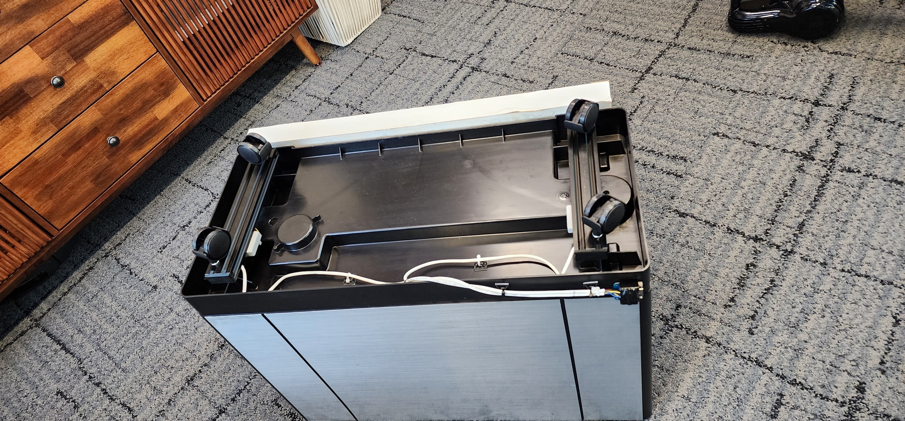
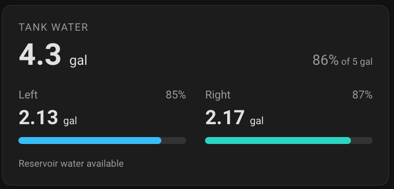
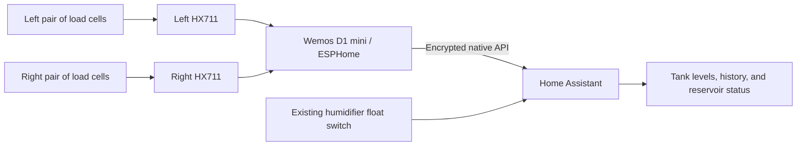

# Humidifier tank scale

Two-channel humidifier scale using a Wemos D1 mini V4.0.0 (ESP8266), two HX711s, and two matched 20 kg full-bridge load cells in parallel per tank. ESPHome exposes both tank readings to Home Assistant. The installed build is documented in the [photo gallery](docs/build-gallery.md).

See [ESPHome wiring and setup](esphome/README.md), the [wiring diagram](docs/two-channel-wiring.svg), the [ESPHome configuration](esphome/humidifier-scale.yaml), and the [Home Assistant dashboard](homeassistant/dashboard.yaml). Both HX711 channels were initially verified with ESPHome 2026.9.1 and Home Assistant; the installed adaptation is described below.

## Build photos

[](docs/build-gallery.md)

[See all seven build photos and the dashboard screenshot with captions →](docs/build-gallery.md)

## Home Assistant dashboard



Overall and per-side water estimates appear together with fill bars and reservoir status. [Dashboard details](docs/build-gallery.md#home-assistant-dashboard).

## Adapting the scale for Home Assistant

The project started as an Arduino bench sketch with a USB/browser graph. For the installed humidifier, we moved the D1 mini to **ESPHome** so Home Assistant could discover its sensors, record history, and manage firmware updates over Wi-Fi. The installed two-channel build was deployed with ESPHome 2026.10.1.



The scale uses the [ESPHome integration](https://www.home-assistant.io/integrations/esphome/) and native API; it does not need an MQTT broker or the laptop graph server. The existing humidifier controller provides the enable relay and float-switch entities separately. The scale firmware measures weight; it does not replace that controller.

### Connect and install

| Channel | HX711 DOUT | HX711 clock |
| --- | --- | --- |
| Left | D5 / GPIO14 | D6 / GPIO12 |
| Right | D7 / GPIO13 | D1 / GPIO5 |

Both HX711s share the D1 mini's 3.3 V supply and ground. Each pair of parallel cells produces one combined reading. See the [physical pinout and wiring diagram](docs/two-channel-wiring.svg) and [detailed ESPHome setup](esphome/README.md).

1. Create an ESP8266 device in ESPHome Device Builder using board `d1_mini`. Use [esphome/humidifier-scale.yaml](esphome/humidifier-scale.yaml) as the hardware starting point, retaining generated Wi-Fi, API encryption, and OTA settings if merging it into an existing device.
2. Copy [secrets.example.yaml](esphome/secrets.example.yaml) to `esphome/secrets.yaml` and replace the placeholders with your own Wi-Fi credentials and API encryption key. Keep credentials out of committed YAML.
3. Install over USB for the initial migration from Arduino. This replaces the Arduino firmware, including its access point and USB graph protocol. Subsequent updates can be installed over the network through Device Builder.
4. In Home Assistant, accept the discovered ESPHome device under **Settings → Devices & services**, or add the ESPHome integration manually using the device's hostname/IP and encryption key.
5. Check both raw channels while loading each side independently. Then add filtering and calibrate the installed assembly before treating any value as gallons or percentage.

**Scope of the examples:** the checked-in ESPHome configuration and [dashboard YAML](homeassistant/dashboard.yaml) are generic raw-reading starting points. The screenshot shows the later calibrated installation described below. Its installation-specific coefficients, private logs, credentials, and complete household dashboard configuration are not distributed with those examples.

### What we added to the readings

Raw ADC counts stay available for troubleshooting. Separate filtered copies feed the water calculations, so filtering does not hide problems in the original signal graphs. Each channel samples once per second and uses a **seven-sample moving median**, publishing every sample, followed by a five-second stale-data timeout.

For example, append this entry under the existing `sensor:` list for the left channel, and repeat it with right-side names and IDs:

```yaml
- platform: copy
  source_id: left_tank_raw
  name: Left Tank Filtered
  id: left_tank_filtered
  filters:
    - filter_out: nan
    - median:
        window_size: 7
        send_every: 1
        send_first_at: 1
    - timeout: 5s
```

Once the window is full, the median rejects up to three isolated outliers within seven samples. A sustained refill or tank removal still passes, with roughly three seconds of delay. Longer disturbances can pass too. See [ESPHome sensor filters](https://esphome.io/components/sensor/#median). Derived water readings update every two seconds and propagate unavailable inputs instead of treating them as zero.

### Calibrating the tanks and reservoir

We first moved the same loaded tank between sides, then checked both tanks together. This exposed a small response on the opposite channel. Later, a complete drain cycle provided a better installed-empty reference and a way to estimate that cross-response during periods when only one tank was draining.

The tank valves are designed to empty one tank before the other. The recorded cycle showed the right tank draining first, followed by the left. Unequal levels are therefore expected; equalizing the readings in software would conceal useful information.

The calibration follows these rules:

- **Tank zero:** both empty tank shells installed in their normal positions, with the reservoir still full. An earlier tanks-removed baseline was replaced so the tank shells are included in the tare.
- **Full:** retain the original full reference and the project's **5 US gallon combined operational target**. A later, slightly underfilled refill did not redefine Full. Side percentages use a nominal 2.5 gallons each; the original full test was not forced into an equal split.
- **Separate levels:** compensate for the small measured cross-response, convert each side to an approximate water estimate, and sum the two for the overall level. A 0.03-gallon per-side deadband suppresses residual readings near empty. Display percentages are bounded to 0–100%.
- **Reservoir:** exclude its water from tank gallons. The transition from one channel draining to both channels falling together helps identify the reservoir-only portion of the cycle; compare this with the float history rather than using the float edge alone as tank zero.

These are practical level estimates, not independently verified precision volume measurements. When adapting the design, determine your own installed-empty and known-load references, check cross-response, and validate a complete drain/refill cycle. Preserve an established Full reference when refining the empty endpoint.

### Home Assistant entities and dashboard

The deployed device publishes these sensor groups. Home Assistant entity IDs depend on the device name; with `humidifier-scale`, they use the `sensor.humidifier_scale_` prefix.

| Sensor names | Purpose |
| --- | --- |
| Left/Right Tank Raw | Original signed ADC counts and diagnostic graphs |
| Left/Right Tank Filtered | Outlier-filtered counts used for calibration |
| Left/Right Tank Water Estimate | Per-side water estimates in US gallons |
| Left/Right Tank Fill Estimate | Per-side percentages using nominal 2.5-gallon capacity |
| Tank Water Estimate | Left plus right, in US gallons |
| Tank Fill Estimate | Overall percentage of the 5-gallon target |
| Tank Fill State | Empty at or below 0.25 gal; Full at or above 4.75 gal; otherwise In between |

The compact card in the screenshot uses **`custom:button-card`**, installed through HACS, to display overall gallons and percentage above separate left/right values and fill bars. Reservoir status is calculated in the dashboard using the existing float-switch entity; it is not an extra sensor wired to the scale's D1 mini.

| Dashboard reservoir message | Meaning |
| --- | --- |
| Reservoir water available | Float indicates usable water and the tanks still contain water |
| Reservoir only · tanks empty | Both tank estimates are zero, while the float still indicates usable water |
| Reservoir low | Float has reached its low-water threshold |
| Reservoir status unavailable | The float reading is unavailable; it is not assumed to mean low water |

A low float does **not** establish a bone-dry reservoir. We have not calibrated an exact reservoir volume in gallons or a true Dry endpoint.

We added the summary and left/right/overall history graphs to the dedicated scale dashboard and to the **humidifier side of the Plant view**, keeping plant moisture and lighting on the other side. The Plant view also retains humidity history, the enable relay, float state, and activity history. Existing total and raw histories remain intact; the newly introduced per-side derived entities start collecting their own history when deployed.

Before updating firmware or dashboard cards, we backed up their configurations so the changes could be undone. For diagnostics, remember that opposite raw signs can come from different bridge offsets, and separate raw graphs choose different vertical scales. Compare changes under load and numeric axis ranges before concluding that wiring is reversed or one side is noisier.

## Original Arduino bench test

The Arduino sketch and USB graph below are the original one-channel bench test. They require the Arduino firmware; ESPHome uses its own logging protocol and Home Assistant graphs.

## Use it

### USB graph on your laptop

```sh
python3 -m venv .venv
.venv/bin/pip install -r requirements.txt
.venv/bin/python scripts/graph.py --port /dev/cu.usbserial-10
```

Open **http://127.0.0.1:8000**. Use your actual USB port. This reads the real serial counts; it does not switch Wi-Fi. Close this process with Ctrl-C before flashing, or using Arduino Serial Monitor/Plotter. The local server retries if USB disconnects. In USB mode timestamps are host receipt times; the on-device Wi-Fi API uses device conversion timestamps. The browser's connection message refers to Wi-Fi; in USB mode check the cable and graph process instead.

### Wi-Fi graph on your phone or laptop

1. Flash `humidifier-scale.ino` with the board set to **LOLIN(WEMOS) D1 R2 & mini**.
2. On a phone or laptop, join **HX711-Scale**, password **hx711test**. Stay connected if it says there is no internet.
3. Open **http://192.168.4.1** (HTTP).
4. Press each cell gently. The signal should change, then return close to its baseline when released. A decreasing reading is fine; calibration can account for the sign.

The graph shows **raw ADC counts, not kg**. **Zero here** subtracts the average of the latest 20 available readings in that browser. **Show raw** removes that offset. Zero is temporary and resets on refresh or device restart. Pause freezes only the graph; acquisition continues. CSV exports the retained minute of raw and offset counts. No smoothing is applied to the plotted signal.

## Wiring

| HX711 | D1 mini |
| --- | --- |
| DOUT / DT | **D5 / GPIO14** |
| SCK / CLK | **D6 / GPIO12** |
| GND | GND |
| VCC / digital supply | 3V3, for a breakout that supports 3.3 V |

Both cells share E+, E−, A+, and A−, matching electrical function, not assumed wire colors. B is unused. This is one combined channel; software cannot read the two parallel cells separately. Calibrate the assembled pair later with known weights. Each cell still has its own 20 kg rating; load distribution matters.

## Build / flash

Dependencies: [ESP8266 Arduino core](https://github.com/esp8266/Arduino) **3.1.2** and **HX711 by Rob Tillaart 0.6.5**. Other HX711 libraries have different initialization APIs. This sketch enables the fast-processor timing option explicitly.

In Arduino IDE, add `https://arduino.esp8266.com/stable/package_esp8266com_index.json` to Additional Boards Manager URLs, install esp8266 3.1.2 and HX711 by Rob Tillaart 0.6.5, select the D1 mini board and USB port, then upload. Keep this folder named `humidifier-scale`.

With Arduino CLI:

```sh
arduino-cli core update-index --additional-urls https://arduino.esp8266.com/stable/package_esp8266com_index.json
arduino-cli core install esp8266:esp8266@3.1.2 --additional-urls https://arduino.esp8266.com/stable/package_esp8266com_index.json
arduino-cli lib install HX711@0.6.5
bash scripts/build.sh
arduino-cli board list
bash scripts/flash.sh /dev/cu.usbserial-10
```

Use the actual port from `board list`. ESP8266 uploading also needs Python 3 with `pyserial` installed; if the core reports that it is missing, install it into your selected Python environment. Build output is in `build/`. GitHub Actions compiles the firmware on each push and attaches a binary artifact.

Arduino Serial Plotter also works at **115200 baud**: after the startup text, every line is a raw reading. Close serial monitors before uploading.

## How it works

The loop reads only when DOUT is ready, using channel A / gain 128. The server returns an 80-sample ring buffer from `/api/readings` every time the browser polls (250 ms between requests). Samples include a sequence and device timestamp, so polls do not duplicate points. The browser retains 60 seconds, marks missed samples, and draws gaps instead of joining missing data. Effective sample rate depends on the HX711 RATE setting and server load; most modules default to 10 SPS. The graph and API stay responsive if DOUT never becomes ready.

No new conversion for 2 seconds displays **HX711 not ready**. This checks conversion activity, not whether the bridges themselves are correctly wired. ADC rail readings trigger a wiring/excitation message. Noise span is the last five seconds' peak-to-peak count range.

## Troubleshooting

- **No Wi-Fi:** reset the D1 mini and check USB power. Startup serial output prints the AP address.
- **Not ready:** check common ground, supply, DT on D5, and CLK on D6.
- **At the ADC limit:** inspect A+/A−, E+/E− and bridge excitation voltage.
- **One cell cancels the other:** test each cell individually and check load direction/polarity before reconnecting the pair.
- **Numbers move with no load:** keep signal wiring short, secure the mounting, and check supply/excitation stability.

## Local UI preview

```sh
python3 scripts/graph.py --demo
```

Open http://127.0.0.1:8000. This serves the exact embedded dashboard with **explicitly labeled simulated data**. It does not test the physical HX711.
