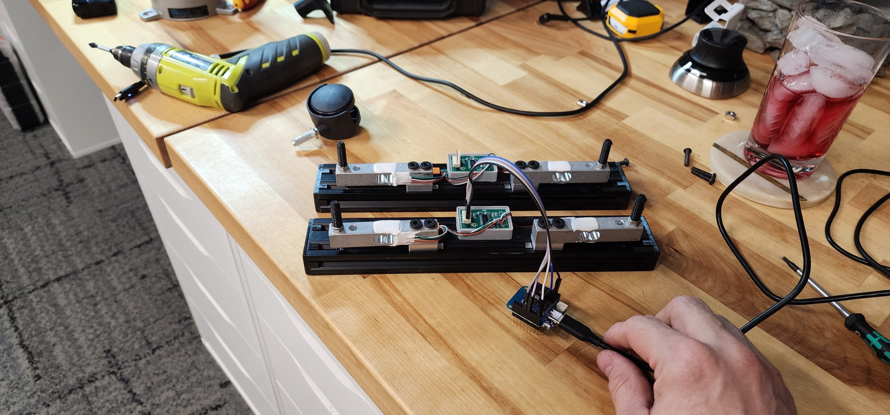
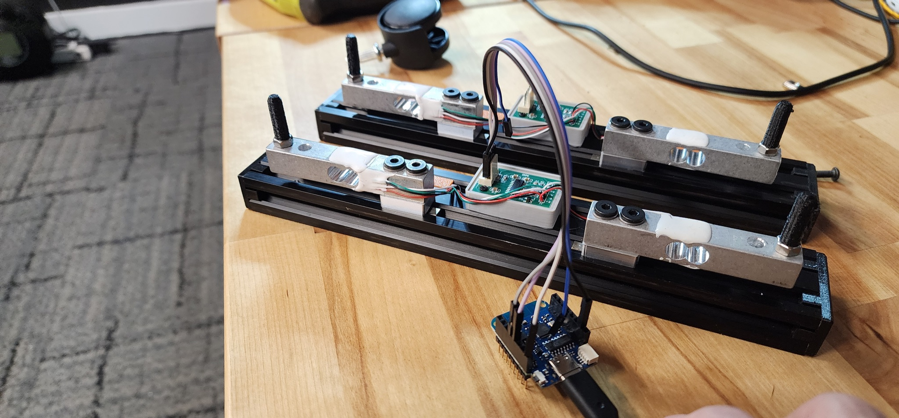
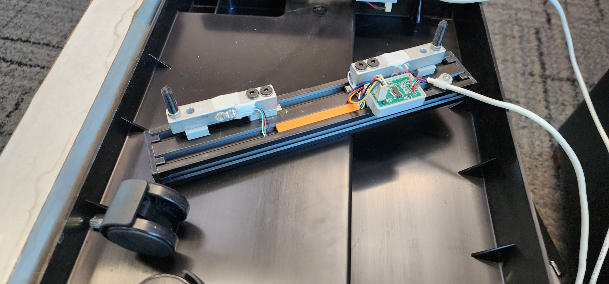
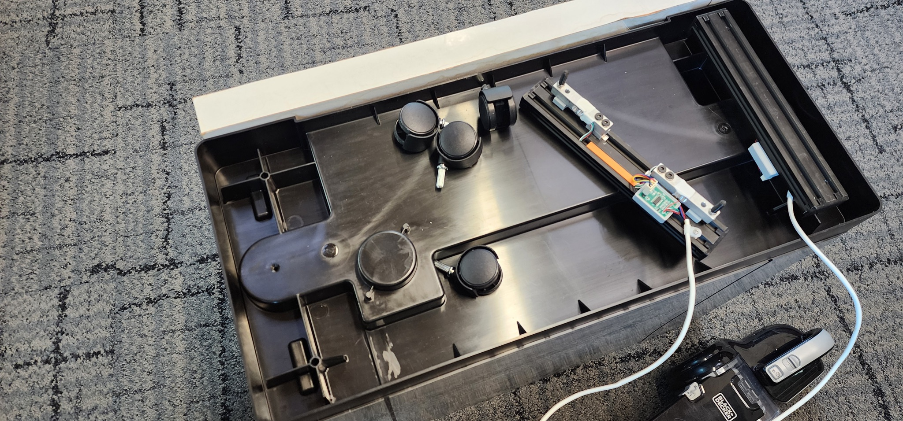
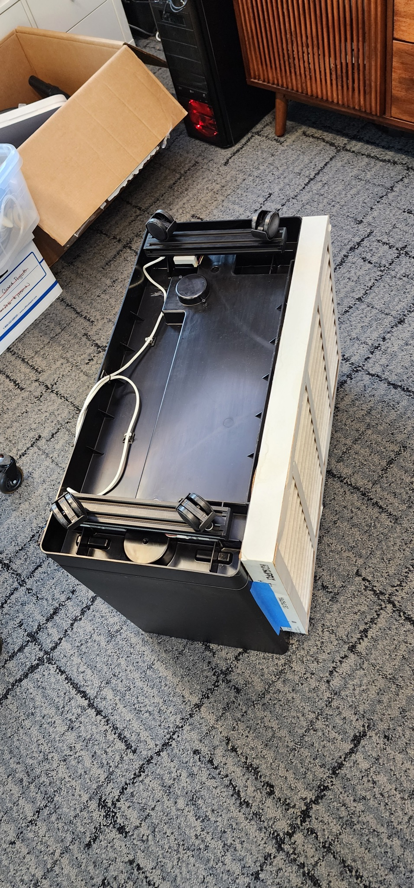
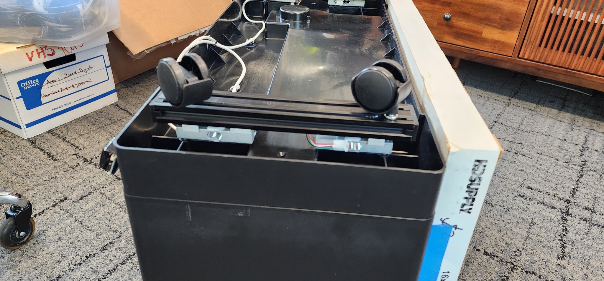
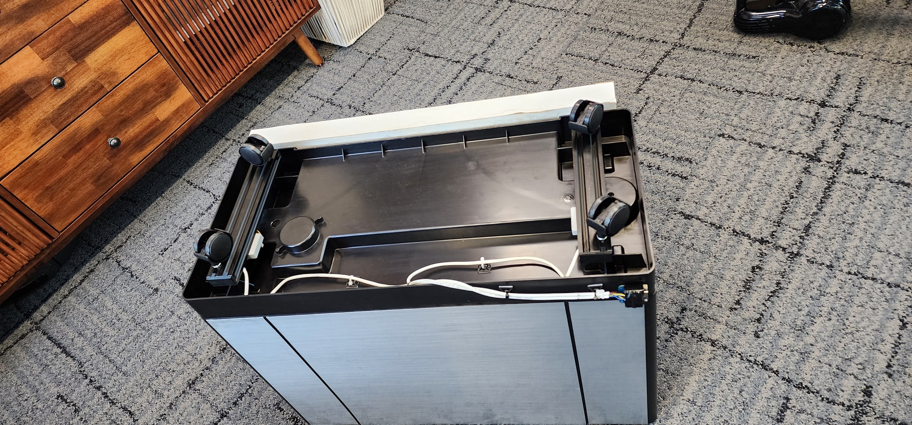
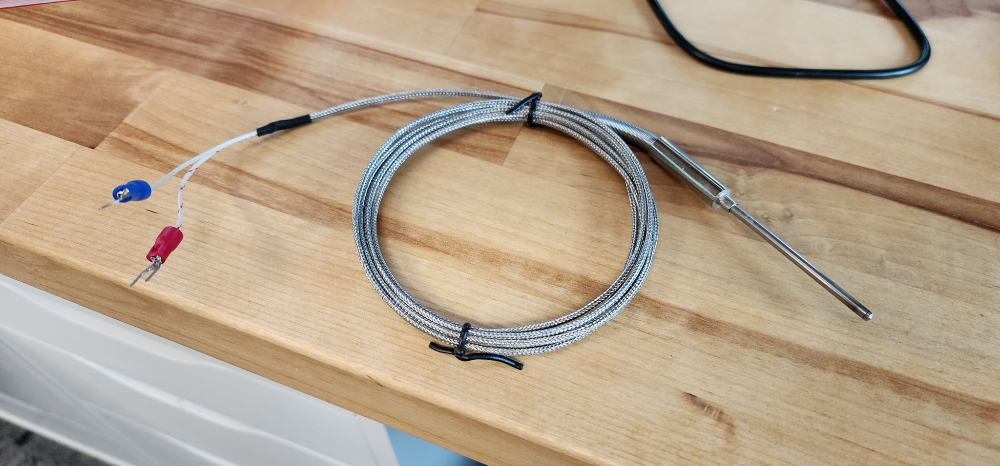

# Humidifier scale build gallery

[Project README](../README.md) · [Wiring diagram](two-channel-wiring.svg) · [ESPHome setup](../esphome/README.md)

The build uses two load-cell rails, one for each side of the humidifier. Each rail has two 20 kg load cells connected in parallel to one HX711. A Wemos D1 mini V4.0.0 reads the two HX711 channels separately and sends the readings to Home Assistant through ESPHome.

## Bench assembly

*The two assembled rails before installation. Each has a pair of load cells and its own HX711 board; the jumper leads connect both channels to the D1 mini.*

*Close-up of the rail hardware, white mounting spacers and HX711 holders, bridge wiring, and USB-powered controller.*

## Installing the rails

*One rail positioned in the overturned base. The original caster nearby shows the mounting arrangement before reassembly.*

*Installation in progress, with the original casters removed and one rail in place.*

## Installed supports and wiring

*Both rails installed with the casters reattached. The white cables run along the underside of the base.*

*Side view of the caster, rail, and load-cell arrangement. The humidifier is upside down in these installation photos.*

*The completed underside: two instrumented rails, four casters, and cables secured along the base.*

For the electrical connections, use the [labeled wiring diagram](two-channel-wiring.svg). The photos document the physical build; wire colors alone do not identify a load cell's electrical functions.

## Separate temperature-probe photo

*An additional hardware photo supplied with this set: a metal temperature probe with braided cable and fork terminals. It is shown separately because it is not part of the HX711 tank-scale wiring.*

---

Photos supplied by the project owner. Documentation copies are resized for the web, stored upright, and omit the original camera/location metadata. The source photos are unchanged.
