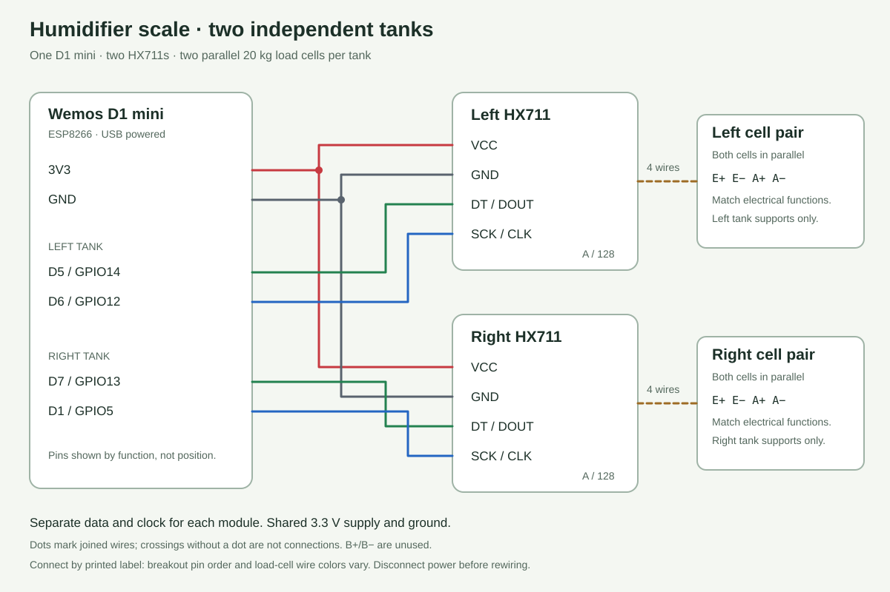

# Two-tank humidifier scale with ESPHome

Each tank has its own independent supports: two matched 20 kg load cells wired in parallel into one HX711. One D1 mini reads both HX711s. Each tank can therefore be calibrated independently.

The diagram includes the **D1 mini V4.0.0 physical header pinout**, viewed from the component side with the antenna at the top and USB-C connector at the bottom. The six pins used by this scale are highlighted. Pin order was checked against the [official Wemos V4.0.0 pinout](https://www.wemos.cc/en/latest/_static/boards/d1_mini_v4.0.0_5_16x9.png).

## Connect the D1 mini

Disconnect power before changing wiring. Connect by printed pin **label**, since HX711 breakout pin order varies.

| D1 mini | Left-tank HX711 | Right-tank HX711 |
| --- | --- | --- |
| 3V3 | VCC | VCC |
| GND | GND | GND |
| D5 / GPIO14 | DT / DOUT | — |
| D6 / GPIO12 | SCK / CLK | — |
| D7 / GPIO13 | — | DT / DOUT |
| D1 / GPIO5 | — | SCK / CLK |

Use a shared 3.3 V supply and ground. These connections assume the working 3.3 V-compatible HX711 breakouts. If a board exposes separate digital VDD and excitation VIN supplies, follow that board's documentation rather than guessing from connector position.

The existing D5/D6 pair is unchanged. Each HX711 gets its own clock and data wire, so ESPHome can read them independently. The HX711 interface is not I2C and has no addresses. GPIO5, GPIO12, GPIO13 and GPIO14 avoid the ESP8266 boot-selection pins GPIO0, GPIO2 and GPIO15.

## Connect each pair of cells

For **each tank separately**, join matching electrical functions from both cells to its HX711:

| Cell 1 + Cell 2 | Their tank's HX711 |
| --- | --- |
| Excitation positive + excitation positive | E+ |
| Excitation negative + excitation negative | E− |
| Signal positive + signal positive | A+ |
| Signal negative + signal negative | A− |

Leave B+/B− unused. Keep the left and right analog bridge wiring separate. Wire colors depend on the cells; use their documented functions. Test that both cells in a pair respond in the same direction under load. Calibrate the whole assembled pair; do not multiply readings by two in software. Each cell retains its own 20 kg mechanical limit.

## Set up ESPHome / Home Assistant

1. In ESPHome Device Builder, create an ESP8266 device named `humidifier-scale`, using board `d1_mini`.
2. Keep its generated Wi-Fi, API encryption and OTA settings. Add the two entries from the `sensor:` block in [humidifier-scale.yaml](humidifier-scale.yaml). If it already has `sensor:`, append to the existing list rather than adding a duplicate key.
3. Alternatively, use the complete file with ESPHome 2026.9 or newer, and [secrets.example.yaml](secrets.example.yaml) copied to `secrets.yaml` and filled in. The example credentials are placeholders. The full file uses the same encryption key for API and OTA.
4. Install over USB for the first migration from the Arduino sketch. Close the USB graph server/Serial Monitor first so the serial port is available. ESPHome firmware replaces the bench sketch, including its `HX711-Scale` AP and raw-serial graph protocol.
5. Once it joins Wi-Fi, add the discovered ESPHome device under Home Assistant **Settings → Devices & services**. If discovery does not appear, add the ESPHome integration using its IP address. Supply the same API encryption key if prompted.
6. Confirm **Left Tank Raw** and **Right Tank Raw** update, then add and remove load from each tank independently. Use ESPHome logs or Home Assistant history to graph them.

This config publishes raw counts once per second through ESPHome's native API. It does not yet claim kg, liters, or fill percentage. No MQTT broker is needed.

## Calibrate each tank next

For each tank, leave its platform and empty tank installed. Record a stable raw reading with the tank empty, then add a known water mass and record another stable reading. Use the mass **actually added**; a kitchen scale is useful. Repeat for the other tank. The direction of the count change may be positive or negative.

Map empty to zero water mass and the loaded reading to the known added mass with ESPHome's `calibrate_linear` filter. Then change the sensor's name, units and device class to describe water mass in kg. Add smoothing after calibration if needed; avoid clamping during initial calibration because it can conceal drift. Water volume and percentage can be derived after we have the measurements and usable capacity for each tank.

Record the actual values here before adding calibration:

| Tank | Empty raw count | Loaded raw count | Added mass (kg) |
| --- | --- | --- | --- |
| Left | | | |
| Right | | | |

## References

- [ESPHome HX711 configuration and calibration](https://esphome.io/components/sensor/hx711/)
- [ESPHome ESP8266 pin restrictions](https://esphome.io/components/esp8266/#gpio-pin-numbering)
- [ESPHome native API](https://esphome.io/components/api/)
- [Wemos D1 mini specifications](https://www.wemos.cc/en/latest/d1/d1_mini.html)
